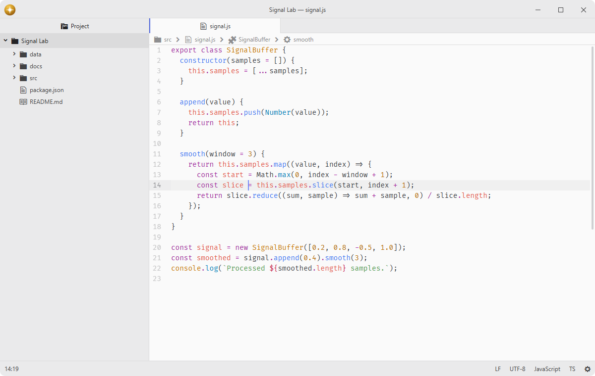

# breadcrumbs

Show file and symbol paths above each pane item.

The bar follows the active item in every non-empty center pane when it exposes a file path. Unsaved text editors can retain a title crumb as an explicit exception, and text editors add symbol segments that jump to their declaration.

## Features

- **Item context**: show a file hierarchy for file-backed items, optionally show titles for pathless items, and control unsaved text editors separately.
- **Symbol path**: follow nested symbols from the shared symbol registry in text editors.
- **Navigation**: reveal path segments in the tree view and jump to symbols.
- **Per-pane state**: every split follows its own active pane item.
- **Document actions**: keep package-provided action buttons beside the breadcrumb path.



## Installation

To install `breadcrumbs` search for it in the Install pane of the Lumine settings, or run the command `lumine --install lumine-code/breadcrumbs`.

Symbol breadcrumbs require the `symbol` package and a compatible symbol provider. The active item path or enabled title fallback remains available without them.

Selecting a document symbol source in `symbol` also updates breadcrumbs and the outline. A file choice affects that editor, and a grammar preference applies to editors without a file choice. Auto restores the hub's normal source preference and fallback. File crumbs remain available while the selected source is loading or unavailable.

Refreshing symbols after edits or saves keeps the current symbol crumbs for up to 200 ms. A quick response replaces them together without an empty intermediate state; a slower response clears them until the new symbols arrive.

## Commands

Commands available in `lumine-workspace`:

- `breadcrumbs:toggle`: show or hide breadcrumbs.

## Usage

Actions remain at the right edge while long paths scroll. Each action belongs to the document shown in its own pane, including when another split has focus. Available actions can show for pathless items even when their breadcrumb paths are hidden. Turning breadcrumbs off hides the entire bar, including actions.

## Customization

Adjust the bar and action buttons in your `styles.css`:

```css
.breadcrumbs {
  color: var(--text-color);
}

.breadcrumbs-action {
  border-radius: 6px;
}
```

## Services

- [`breadcrumbs.actions`](docs/breadcrumbs.actions.md): provided to register document actions beside every pane's breadcrumb path.
- `background-tips.provider`: provided to show navigation tips in an empty workspace.
- `symbol.registry`: consumed to follow the current text-editor symbol path.
- `tree-view.selection`: consumed to reveal file paths in the tree view.

## Contributing

Got ideas to make this package better, found a bug, or want to help add new features? Just drop your thoughts on GitHub. Any feedback is welcome!
